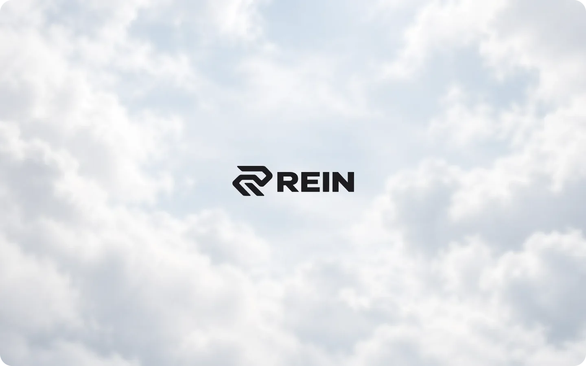
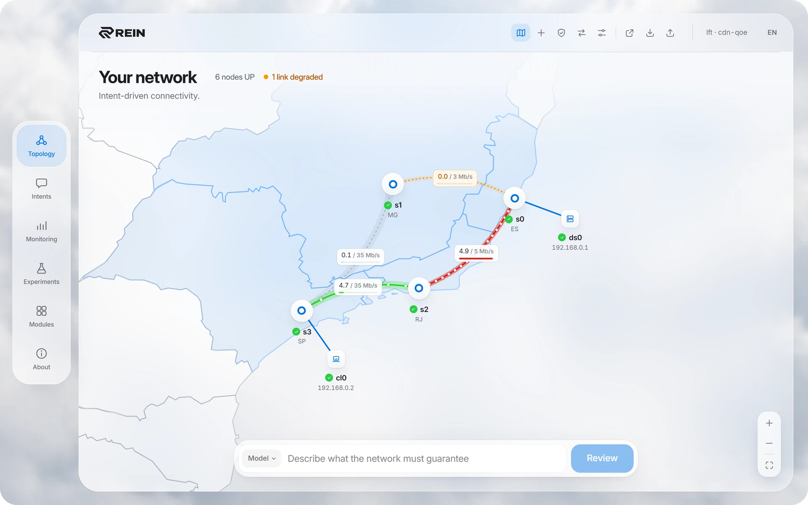
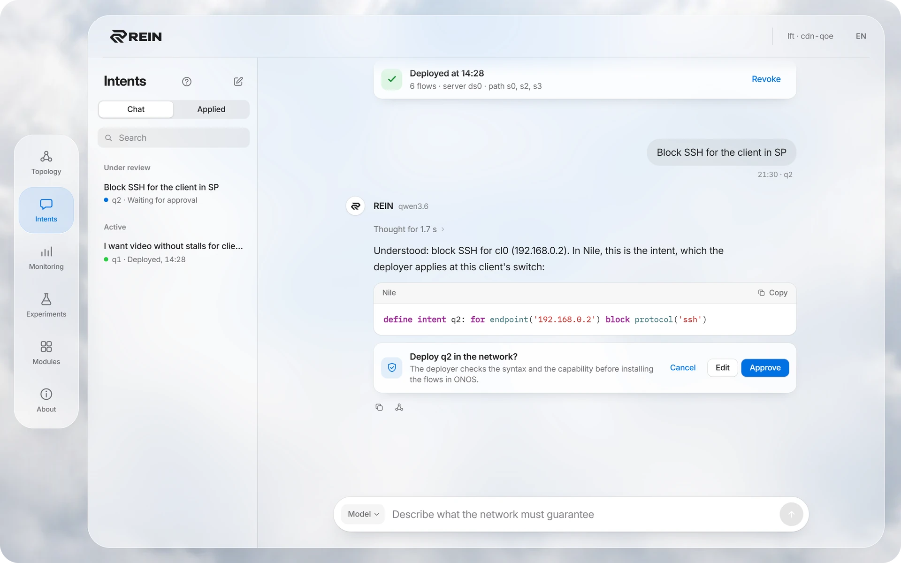
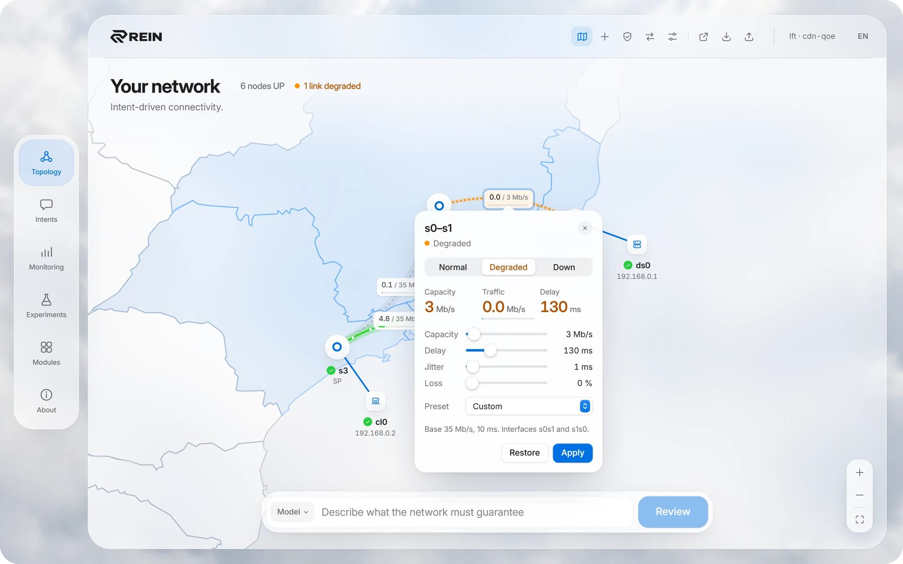
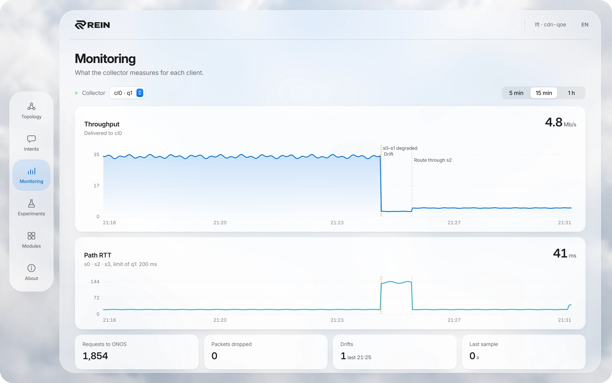
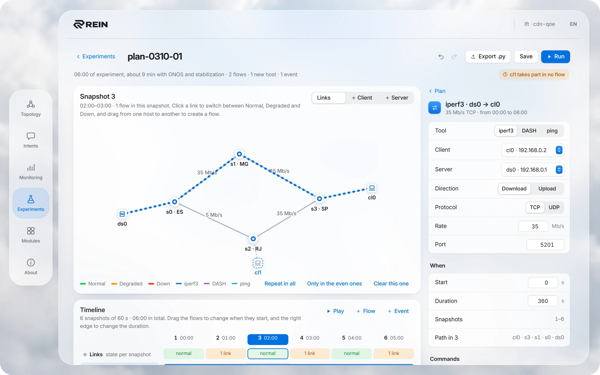
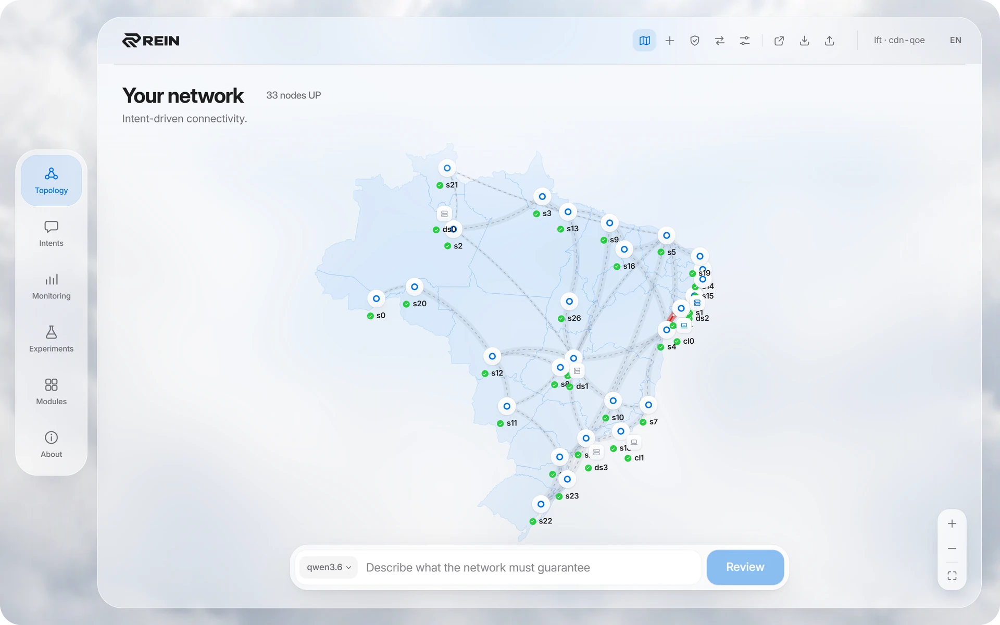
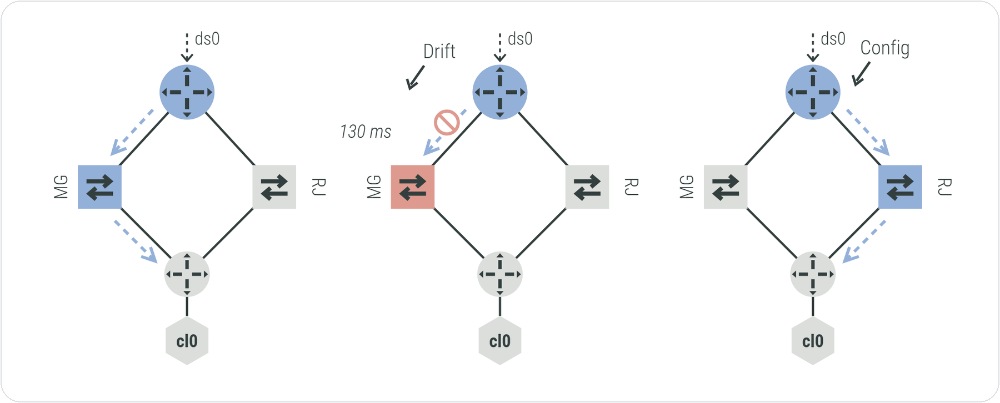
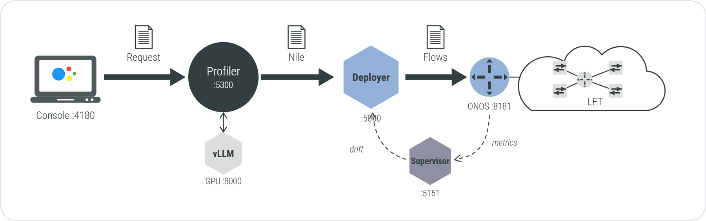

<h1 align="center">
  <picture>
    <source srcset=".github/assets/banner.webp" type="image/webp">
    
  </picture>
</h1>

<p align="center">
  <b>Say what the network must guarantee. REIN translates it, deploys it and keeps watch.</b><br>
  <sub>Intent-Based Networking on ONOS: from a sentence in natural language to flow rules on the switches.</sub>
</p>

<p align="center">
  <a href="#the-console">Console</a> ·
  <a href="#how-it-works">How it works</a> ·
  <a href="#modules">Modules</a> ·
  <a href="#running-rein">Running REIN</a> ·
  <a href="#the-model-that-translates-the-requests">Models</a> ·
  <a href="#running-only-the-services">Services only</a>
</p>

<p align="center">
  <a href="./LICENSE"></a>
  <a href="https://onosproject.org"></a>
  <a href="https://github.com/UnB-COMNET/lft"></a>
  
  
</p>

REIN (REdes de INtenções, Portuguese for "Intent Network") is an Intent-Based Networking (IBN) system designed to simplify network management. Instead of manually configuring low-level network rules, REIN allows users to express desired network behaviors (intents) and automatically translates them into actionable configurations within the network infrastructure.

REIN was developed to operate on top of the [ONOS](https://onosproject.org) (Open Network Operating System) controller.

```text
You     I want video without stalls for the client in SP
REIN    define intent q1: for endpoint('192.168.0.2') add service('cdn-qoe')
```

## The console

<p align="center">
  
</p>

One window to build and operate the testbed, write and approve intents, watch the network and run experiments. Every action runs through LFT's CLI on a real testbed: containers, veth pairs with tc queues and Open vSwitch under ONOS.

<table>
  <tr>
    <td width="50%"><br><b>Topology</b><br><sub>The testbed on the map: switches by state, link capacity and the traffic on each link.</sub></td>
    <td width="50%"><br><b>Intents</b><br><sub>A chat with the profiler: the request, the Nile it wrote and your approval before anything is deployed.</sub></td>
  </tr>
  <tr>
    <td><br><b>Links</b><br><sub>Normal, degraded or down in one click, with capacity, delay, jitter and loss.</sub></td>
    <td><br><b>Monitoring</b><br><sub>Throughput and path RTT for each client, with the drifts and the reroutes.</sub></td>
  </tr>
  <tr>
    <td><br><b>Experiments</b><br><sub>Hosts, flows and link states on a timeline, exported as a <code>.py</code> plan.</sub></td>
    <td><br><b>Any topology</b><br><sub>The <code>rnp</code> backbone, imported from a <code>.py</code> file.</sub></td>
  </tr>
</table>

## How it works

1. **Ask.** The operator writes the request in the console, in English or Portuguese.
2. **Translate.** The profiler grounds the request in the network's inventory, retrieves the closest examples and has the model write one Nile intent, or ask when something is missing.
3. **Approve.** Nothing reaches the deployer without the operator's approval.
4. **Deploy.** The deployer checks the intent's syntax and whether it can execute it, computes the path and installs the flow rules on ONOS.
5. **Assure.** The supervisor measures each client's path and asks for a new route when it drifts.

<p align="center">
  
</p>

What the deployer executes, all for `for endpoint('<client ip>')`:

| Operation | Effect |
|-----------|--------|
| `add service('cdn-qoe')` | Picks the CDN server and the path, installs it and hands it to the supervisor |
| `remove service('cdn-qoe')` | Removes the client's path and stops its supervision |
| `set bandwidth('max', '<n>', '<unit>')` | A DROP meter on what reaches the client, at the client's switch |
| `block protocol('<p>')` | Drops `tcp`, `udp`, `icmp`, `ssh`, `http` or `https` to and from the client, at its switch |
| `unset bandwidth(...)`, `allow protocol(...)` | Remove the policy above |

## Modules

<p align="center">
  
</p>

- **[Deployer](./deployer)** - The engine responsible for processing Nile intents, computing optimal paths, and actively installing flow rules on the ONOS controller.

- **[Supervisor](./supervisor)** - An assurance component responsible for triggering route recalculation whenever service degradation is detected.

- **[Profiler](./profiler)** - Translates requests in natural language into Nile intents, which the operator approves before they reach the deployer.

- **[Console](./console)** - A web console to build and operate the testbed, write and approve intents, watch the network and run experiments.

> Each module directory also contains its own README file with more detailed documentation, usage instructions, and information for running modules individually.

## Running REIN

Everything runs on one Linux machine: the [LFT](https://github.com/UnB-COMNET/lft) testbed (ONOS and Open vSwitch in Docker), the REIN services, the language model and the console.

### What the machine needs

- Ubuntu 24.04 or Debian 13, with `sudo`, `git` and Python 3.
- About 6 GB of disk for the images of the testbed and of the services.
- For requests in plain language, an NVIDIA GPU with 4 GB of VRAM or more and its driver installed (`nvidia-smi` answers). The model is a 10 GB image plus about 2 GB of weights. Without a GPU REIN runs all the same, and the chat takes the intents written in Nile.

### From zero

```bash
git clone https://github.com/UnB-COMNET/REIN.git
cd REIN
./rein setup     # once per machine
rein up
```

`./rein setup` installs what is missing, through `sudo`:

- LFT, cloned next to REIN, with its `dependencies.sh`: Docker, Open vSwitch, the `lft` command and the ONOS and switch images
- the video images of the testbed and the images of the REIN services
- `deployer/.env`, with ONOS's default credentials
- the NVIDIA Container Toolkit, when the machine has an NVIDIA GPU (this restarts Docker)
- `sudo` without a password for `lft` and `docker`, the console's service and the `rein` command

`rein up` builds the testbed, starts the services, the model that fits the machine and the console, which is then at http://localhost:4180 (it listens on 127.0.0.1 only: from another machine, `ssh -L 4180:127.0.0.1:4180 <user>@<machine>`). The first `rein up` on a machine with a GPU downloads vLLM's image and the model's weights, so it takes several minutes.

```bash
rein status      # what is up
rein model       # the models and the one in use
rein logs <service>
rein down        # stops everything, --keep-testbed leaves the testbed running
```

`rein up --topology <preset or file>` builds another testbed. The console is in English, with Portuguese as an option in its header. Its Monitoring page reads what the collector module stores (`collector/`, with its OpenTelemetry collector and ClickHouse on 127.0.0.1) when the checkout has it.

### The model that translates the requests

The models run on the machine itself, with vLLM ([`llm/compose.yml`](./llm/compose.yml)). `rein up` picks one from [`llm/models.yaml`](./llm/models.yaml), largest first: one whose server already answers, else the largest that fits the free memory of the GPU, which it starts.

| Model | Takes | For |
|-------|-------|-----|
| `llama` (Llama 3.2 3B, AWQ 4-bit) | 4 GB | cards with more than 4 GB |
| `lite` (Qwen2.5 1.5B, AWQ 4-bit) | 3 GB | 4 GB cards (ultra-lite) |

With less than 3 GB of VRAM free, or no NVIDIA GPU, no model runs. The chat then takes the intent written in Nile, which it accepts on any machine: a request that starts with `define intent` goes to approval as written, with no model.

`rein model lite` puts another model in use, as the console's model menu does: the model REIN started is stopped, so its memory counts as free. One that does not fit is refused. The menu's **Direct Nile** sends the intents as written, with no model.

A model that another machine on the network serves is declared in `llm/models.local.yaml`, a file of the machine that stays out of git ([`llm/models.local.example.yaml`](./llm/models.local.example.yaml)). It is used wherever its server answers, and REIN never starts or stops it.

## Running only the services

The deployer, supervisor and profiler also run on their own with Docker Compose, against an ONOS that is already up. `deployer/.env` holds ONOS's credentials (`ONOSUSER`, `ONOSPASS`).

### First-time setup (build and start)

```bash
docker compose up --build
```

### Starting the environment later

```bash
docker compose up
```

### Running in detached mode (recommended)

```bash
docker compose up -d
```

### Stopping the environment

```bash
docker compose down
```

### Rebuilding containers after changes

```bash
docker compose up --build -d
```

## Additional Notes

* Make sure Docker is running before starting the environment.
* Depending on the modules enabled, some services may take a few moments to become fully available.
* Check individual module READMEs for specific configuration details and standalone execution instructions.

## License

[MIT](./LICENSE) © 2026 UnB-COMNET. Intents are written in Nile, the intent language of [Lumi](https://www.usenix.org/conference/atc21/presentation/jacobs) (Jacobs et al., USENIX ATC 2021).
